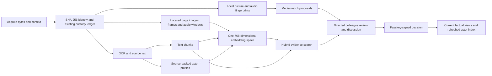

# Discovery and collaborative review

Source files: `sealbook/discovery/`, `sealbook/collaboration/`, `sealbook/ledger/origins.py`,
`sealbook/review/views.py`. Configuration and commands are in [operations.md](operations.md).

## How the parts connect

### Picture and sound

Images use PDQ. Videos produce timestamped PDQ samples and audio landmarks from
one ffmpeg invocation. Audio files use the same landmark path. Landmarks match on
time offset, so an excerpt can be located inside a longer recording. Silent or
missing sound is an explicit status, not a failed match that proves originality.

Picture candidates use a pgvector HNSW bit index. Sound candidates use indexed
landmark hashes. Candidate retrieval is bounded and approximate: up to 32 visual
query samples, 4096 distinct audio hashes, and `MEDIA_CANDIDATES` final candidates.
No suggestion is evidence that no relationship exists elsewhere in the archive.

The proposal keeps the two measurements separate. PDQ distance 31 and quality 50
are configurable retrieval parameters from the reference algorithm, not calibrated
probabilities. Audio alignment reports agreeing landmarks, total shared landmarks
and offset, without a fabricated confidence percentage.

A reviewer chooses same recording, contains, contained in, or related event.
Only a confirmed same-recording relationship collapses whole-source origin counts.
Contains relationships do not collapse whole compilations. Undo restores the prior
origin calculation. These changes queue affected actor profiles for re-embedding.
Files and acquisitions are preserved. Rebuilds keep human-rejected media pairs
rejected, including when the search direction is reversed.

Media relationship proposals remain advisory and cannot be cited as package facts.
Exporting a relationship itself needs complete closure over both sources and their
fingerprint basis. Existing source-backed factual packages remain available.

### Embeddings

Text chunks retain exact offsets in their immutable source. Keyword search uses
a normalized trigram index. Arabic passage search folds presentation forms, digits,
diacritics, hamza on alef, alef maqsura, ta marbuta and format characters while
mapping matches back to the unchanged source. Hamza on waw or ya (ؤ, ئ) is not
folded yet. Identifier boundaries are checked before the candidate limit.

Search answers exact signals first, in this order: SHA-256 or prefix, literal
words, normalized words, all words in any order, file name or origin, another
recorded spelling of a matched person, and another gazetteer name of a matched
place. Leads by meaning follow: segments near the query vector and segments near
the exact hits (`near_match`). Each source appears once, with up to five further
located hits in `also`. Leads carry their cosine similarity, which is not a
probability; no threshold is applied because irrelevant and relevant scores
overlap. A hash query skips meaning. If the embedding service fails, exact results
still return and the response reports `semantic.status = failed`.

`POST /api/search` groups people, places, sources, passages, media, claims,
findings and incidents for the page at `/search?q=`. Personal values and source
text from a sensitive source stay masked in results, and thumbnails appear only
for sources revealed in the session. [search-eval.md](search-eval.md) holds the
rerunnable battery and its results.

PDF jobs extract text per page into immutable derived blobs. Results open the
matching page and highlight its extracted text after reveal. Pages without text
remain explicit coverage gaps; automatic OCR for scanned PDFs is not implemented.

Actor profiles are assembled from current, non-rejected source-backed claims,
including property, value, date and review tier. Their canonical source references
and hash are recorded with the run. Embeddings are leads for inspection, never
identity merges or proof of corroboration. Changed or erased profiles are excluded
from semantic results until the index is refreshed.

Text passages, actor profiles and media share one 768-dimensional EmbeddingGemma 2
space served by local Ollama, so one query can return passages, pages, frames
and audio windows. The server must expose `/embeddings` and report the model it
served. No cloud fallback is used. A changed model alias requires an
explicit rebuild when reference vectors drift. These probes detect changes on a
fixed non-sensitive sample, not every possible weight or tokenizer change.

Media inputs are prepared images, PDF pages, video frames
every three seconds and overlapping audio windows of up to 30 seconds with a
25-second hop. Search returns page/time locations. Typed nested media input and
distinct image/audio probes reject a server that ignores the media content.
Semantic search is independent of PDQ and audio landmark reuse detection. No live weights
have been installed or measured. See [models.md](models.md).

Text, PDF and media jobs process bounded batches and queue continuations with a
short delay so new evidence can run. Coverage shows completed/total work and
current vector counts under the active filter. Failed jobs, unreadable PDF pages,
stale model generations and the 100-source reporting cap prevent a complete
coverage claim. A zero-result search never establishes absence from the archive.
Fingerprint decoding remains bounded by file duration and is not progressive.

### Analysts working together

An analyst can send a pending claim for review or propose a corrected value with a
source span. The proposal preserves its predecessor and stays unconfirmed. Its
author is attributed through the authenticated session; the accepting or rejecting
reviewer signs the decision with a passkey. An analyst cannot approve their own
assigned correction. Assignment checks also apply to undo, with an admin override.
Decisions are made on `/review`, which shows each claim with its source at the span
(see [status.md](status.md)); conversation lives on `/inbox`.

Requests and comments are chained, participant-only records. General monitor and
MCP reads exclude them. The inbox persists across disconnection; WebSocket notices
contain a request link rather than sensitive evidence. Media previews require an
explicit logged reveal and verify source bytes before playback.

### Evidence page

`/evidence/<sha>` shows one acquired source: preview, claims and an intelligence
panel (Read, Copies, Relations, Metadata with the custody chain), with threads
and decision history in a side drawer. `?with=<sha>&at=<ms>` opens a second
source side by side; `?segment=<id>&start=&end=` opens a search hit at its page,
second or characters. `/evidence/segments/<id>` renders the same page.

A sensitive source shows nothing until "Show sensitive item (access is logged)",
which records the reveal. Any other source is shown at once; the first content,
text or frame load in a login session writes one `access` `view` statement;
thumbnail tiles write none (see [decisions.md](decisions.md)). The item API (`GET /api/evidence/<sha>/item`) masks
personal values of sensitive sources exactly as the monitor does. Source text, page
text and unmasked claim values come only from `GET /api/evidence/<sha>/read`, under
the same rule. Indexed frames are served by `GET /api/evidence/<sha>/segments/<id>/image`,
only for their own source; `GET /api/evidence/<sha>/content?raw=1` returns PDF bytes
for the pdf.js viewer. An erased source returns 404 on the page and every API.

Viewers are reusable ES modules in `sealbook/static/js/components/` (image, video,
audio, PDF on vendored pdf.js 4.10.38, thumbnail tile), registered with
`registerMediaViewers(app)` from `components/media.js`. Every request on the page
times out after 15 seconds and shows a Retry in place. Monitor document clicks and
file previews open the evidence page.

Accept and reject use the passkey review flow; the page offers them only where
`check_reviewer` would allow the decision. Nearest-by-meaning, same-place and
recorded excerpt links are leads with no decision. Strength bands for copies,
same-person proposals and meaning distance are carried over from the approved
mockup and are not calibrated. Audio shows transcript lines that follow playback; they
come from local speech to text (faster-whisper large-v3-turbo), whose segments are
located in milliseconds. A claim extracted from the transcript points at characters of
the joined transcript; `GET /api/evidence/<sha>/read` returns a `timeline` of
`[char offset, start ms, end ms]` per line from each transcribe run's segments, and
selecting such a claim seeks the player to that line. Incidents are not listed yet.

Accepted corrections replace earlier claims in current person and factual-package
views and remove their old corroboration support. Undo restores that support.
History remains intact. Erasure removes descendant discussion payloads and
affected search projections; erased source material cannot be used for corrections
or returned through media preview. Existing physical blob erasure and encryption
limitations in [status.md](status.md) still apply.

